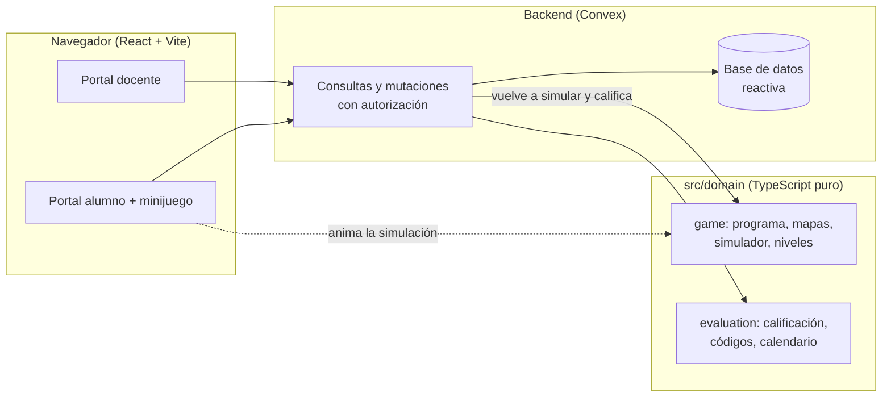

# RoboLab

Retos de programación con un robot, para Inicial y Primaria, en dos modos:

- **Explorar retos (sin cuenta).** Cualquiera entra, elige un tópico y un
  nivel y resuelve retos de pensamiento computacional: armar la secuencia,
  esquivar obstáculos, predecir dónde termina el robot, corregir un programa
  con error, pasar por paradas y resolver con pocos bloques. Wayra, la guía,
  reacciona a cada intento y da hasta 3 pistas. El avance se guarda en el
  dispositivo.
- **Clases.** El docente arma evaluaciones (preguntas, alternativas, respuesta
  correcta y puntaje); el alumno entra con un código, programa el robot y cada
  vez que llega a una estrella se desbloquea una pregunta. El docente ve los
  resultados en vivo, un ranking y el desarrollo del aprendizaje.

Como extra, el mismo programa se puede enviar a un robot físico (ESP32) por
wifi con el botón "Enviar al robot": ver [docs/robot-wifi.md](docs/robot-wifi.md)
y el firmware en `firmware/robolab_robot/`.

Hecho para el track **Educación Escolar** de Hack the Andes 2026.

## Qué hace

**Explorar retos**

- Portada con los cinco tópicos STEAM; Tecnología ya tiene 11 retos (5 de
  Inicial y 6 de Primaria) y los demás se muestran como "Próximamente".
- Cada reto tiene una ficha (historia, tiempo, habilidad, vista previa del
  tablero), el juego con Wayra y sus pistas, y "¡Reto logrado!" con intentos,
  pistas y tiempo.
- "Mi avance" muestra lo resuelto por tópico en ese dispositivo.
- Cada partida resuelta se registra de forma anónima (un identificador al azar
  del dispositivo, sin nombres) para medir el uso real; el servidor vuelve a
  revisar si el reto se resolvió. `npx convex run explore:stats` da las cifras.

**Docente**

- Se registra e inicia sesión con correo y contraseña. La contraseña pide
  minúscula, mayúscula, número, símbolo y 8 caracteres, y el formulario marca
  cada regla mientras se escribe.
- Si la olvida, recibe un código de 6 dígitos en su correo registrado (vence
  en 15 minutos). La app solo dice "te enviamos un código" si el correo salió;
  si no hay cuenta con ese correo o el envío falla, lo avisa.
- Al entrar ve sus clases y las evaluaciones de hoy.
- Crea clases (nivel, grado y sección) y agrega alumnos: cada uno recibe un
  código de 6 caracteres que se puede copiar o imprimir en tarjetas. Los
  nombres se revisan antes de guardar: solo letras (con tildes, ñ, guion y
  apóstrofo), sin números, símbolos, emojis ni caracteres invisibles pegados
  desde otro programa, y sin repetidos.
- Crea evaluaciones: título, clase, fecha y de 1 a 10 preguntas con 2 a 4
  alternativas (admiten emojis), respuesta correcta y puntaje. Puede ordenar
  las preguntas y deshacer una eliminación; cada error se marca en su campo.
- Ve los resultados en vivo y un ranking que solo ve el docente: más puntaje;
  a igual puntaje, menos veces rendida, menos intentos de ejecutar y menos
  tiempo.
- Ve el desarrollo del aprendizaje con cuatro medidas (logro, intentos por
  estrella, tiempo y veces que la rindió), el promedio de la clase y la
  comparación con cada alumno, con tabla de detalle.

**Alumno**

- Entra con su código, sin cuenta ni contraseña.
- Ve directamente su evaluación del día.
- Arma un programa tocando bloques (avanzar, girar; en Primaria también
  retroceder y repetir) y lo ejecuta. Si el robot se sale del camino, se le
  dice en qué paso y se marca ese bloque.
- Al llegar a la estrella aparece la pregunta, que también se lee en voz alta.
- Al final ve su puntaje, el tiempo total, cuántas veces ejecutó el robot y el
  tiempo de cada respuesta. Puede intentarlo de nuevo: cuenta su mejor
  puntaje y cuántas veces lo necesitó.

## Arquitectura



- **Dominio puro y compartido** (`src/domain`). Las reglas del juego y de la
  calificación no dependen de React ni de Convex. El navegador las usa para
  animar al robot y el servidor las usa para validar: es el mismo código.
- **Mismo motor en todo.** Los retos abiertos y las evaluaciones usan el mismo
  intérprete y el mismo simulador (`src/domain/game`); los retos agregan su
  revisión en `src/domain/explore` (paradas, límite de bloques, predicción).
- **El servidor manda.** Cada vez que el alumno toca "Ejecutar", el servidor
  simula el mismo programa y lo anota (así los intentos son confiables); solo
  si llegó a la estrella muestra la pregunta.
  Los tiempos de respuesta salen del reloj del servidor.
- **La respuesta correcta nunca viaja al alumno.** Las consultas del alumno
  devuelven la pregunta sin la alternativa correcta.
- **Cada docente solo ve lo suyo.** Toda consulta pasa por una guarda de
  autorización (`convex/lib/access.ts`); los alumnos usan una sesión de 8 horas
  ligada a su código.

### Patrones

| Patrón | Dónde | Para qué |
|---|---|---|
| Intérprete | `src/domain/game/program.ts` | Bloques → comandos, con límites de pasos y anidamiento |
| Estrategia | `src/domain/game/levels.ts` | Cada nivel define sus bloques y mapas; Primaria y Secundaria se agregan sin tocar el simulador |
| Objeto de valor | `src/domain/evaluation/accessCode.ts` | Códigos sin letras confusas (sin O/0, I/1/L) |
| Reductor | `src/domain/game/editor.ts`, `questionDraft.ts` | Editores con estado predecible y probado |
| Guardas | `convex/lib/access.ts` | Autorización en un solo lugar |
| Adaptador | `convex/lib/mailer.ts` | El proveedor de correo se cambia por configuración, sin tocar el flujo |
| DTO | `convex/student.ts` | Lo que ve el alumno, sin datos sensibles |

### Carpetas

```
src/domain/        reglas puras (juego, evaluación, nombres y contraseña) con sus pruebas
src/features/      pantallas: teacher/, student/, game/
src/shared/        estilos, errores y componentes comunes
convex/            esquema, funciones del backend y sus pruebas
convex/lib/        autorización, validaciones, códigos y datos de demostración
public/            gráficos del robot, bloques y estrella
```

## Cómo correrlo

Requisitos: **Node 22.12 o superior** (hay un `.nvmrc`) y git.

```bash
git clone https://github.com/orinqq/robolab.git
cd robolab
npm ci
```

**1. Backend (Convex).** En una terminal, y dejarla abierta:

```bash
npx convex dev
```

La primera vez pregunta cómo trabajar: elige **correr Convex en local, sin
cuenta** (o inicia sesión si vas a usar la nube). Crea tu propio backend, sube
las funciones y escribe `.env.local` con su dirección. Cada computadora tiene
su backend y sus datos; no se comparten.

**2. Configuración del backend (una vez).** En otra terminal:

```bash
npm run setup
```

Genera las claves de inicio de sesión del docente (`JWT_PRIVATE_KEY`, `JWKS`),
fija `SITE_URL` en `http://localhost:5173` y deja el correo de recuperación en
modo consola (`MAIL_PROVIDER=console`: el código aparece en `npx convex logs`).
Solo agrega lo que falta; se puede correr de nuevo sin riesgo.

**3. Web.**

```bash
npm run dev
```

Abre http://localhost:5173. Sin cuenta se juegan los retos; en "Soy docente"
se crea una cuenta local.

Para enviar correos de verdad, el despliegue necesita `MAIL_PROVIDER=resend`,
`RESEND_API_KEY` y `MAIL_FROM` (con `npx convex env set`, nunca en el código).
`.env.example` resume todas las variables.

### Datos de demostración

Para presentar la gráfica con historia: registrar un docente en la app y luego
(en bash o PowerShell; en cmd las comillas simples no funcionan)

```bash
npx convex run demo:seed '{"email":"correo-del-docente","today":"AAAA-MM-DD"}'
```

Agrega una clase de Inicial con 12 alumnos ficticios, cuatro evaluaciones
pasadas ya rendidas y una para hoy que se puede jugar en vivo. Las notas salen
de respuestas simuladas con semilla fija y se califican con las mismas reglas
que una evaluación real. Es una función interna: no se puede llamar desde el
navegador y no guarda contraseñas.

## Pruebas y calidad

Para colaborar (personas o agentes de IA), las reglas del código están en
[AGENTS.md](AGENTS.md). GitHub Actions corre `npm run verify` en cada push y pull request.

```bash
npm run verify
```

Corre, en orden, el chequeo de tipos, ESLint, las pruebas (Vitest, con
`convex-test` para el backend) y el build. Las pruebas cubren el intérprete de
bloques, el simulador, que todos los mapas tengan solución, la calificación,
los códigos y, en el backend, la autorización entre docentes, la validación de
datos y el flujo completo del alumno.

## Decisiones

- **Convex** como backend: base de datos reactiva (los resultados en vivo no
  necesitan código extra), funciones tipadas de punta a punta y autenticación
  integrada.
- **Editor de bloques por toques**, no por arrastre: más fácil para manos de
  5 años y para pantallas táctiles.
- **Retroalimentación determinista**: el simulador dice en qué paso falló el
  robot. No se usa un modelo de IA para corregir, así que el resultado es
  explicable y no tiene costo por uso.
- **Fechas como texto `AAAA-MM-DD`**: "hoy" significa lo mismo para el docente,
  el alumno y el servidor, sin problemas de zona horaria.
- **Gráfica en SVG propio**, sin librería: liviana, accesible (leyenda,
  etiquetas directas, tabla) y con colores probados para daltonismo.

## Créditos

Los gráficos del robot y de los bloques vienen del kit Inrobit que el equipo
hizo en 2025. Wayra se dibuja con [blobatar](https://github.com/Alain00/blobatar)
(MIT), en el navegador y sin conexión a terceros. Todo el código de esta
aplicación es nuevo.
