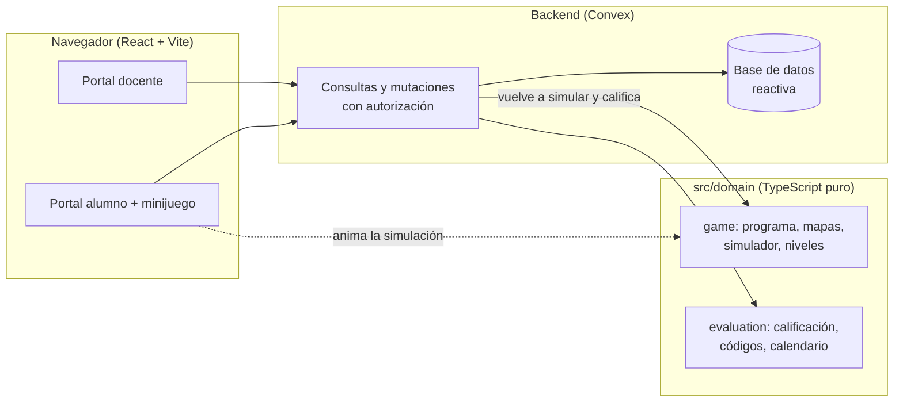

# Inrobit Aula

Evaluaciones de Inicial que se rinden jugando. El docente arma la evaluación
(preguntas, alternativas, respuesta correcta y puntaje); el alumno entra con un
código, programa un robot con bloques y cada vez que el robot llega a una
estrella se desbloquea una pregunta. Al final ve su puntaje y cuánto tardó.
El docente sigue el avance de su clase en vivo y en una gráfica de progreso.

Hecho para el track **Educación Escolar** de Hack the Andes 2026. Pensado para
Inicial y listo para crecer a Primaria y Secundaria.

## Qué hace

**Docente**

- Se registra e inicia sesión con correo y contraseña.
- Al entrar ve sus clases y las evaluaciones de hoy.
- Crea clases (nivel, grado y sección) y agrega alumnos: cada uno recibe un
  código de 6 caracteres que se puede imprimir.
- Crea evaluaciones: título, clase, fecha y de 1 a 10 preguntas con 2 a 4
  alternativas (admiten emojis), respuesta correcta y puntaje.
- Ve los resultados en vivo mientras los alumnos juegan.
- Ve el desarrollo del aprendizaje: porcentaje de logro por evaluación, el
  promedio de la clase y la comparación con cada alumno, con tabla de detalle.

**Alumno**

- Entra con su código, sin cuenta ni contraseña.
- Ve directamente su evaluación del día.
- Arma un programa tocando bloques (avanzar, girar; en Primaria también
  retroceder y repetir) y lo ejecuta. Si el robot se sale del camino, se le
  dice en qué paso y se marca ese bloque.
- Al llegar a la estrella aparece la pregunta, que también se lee en voz alta.
- Al final ve su puntaje, el tiempo total y el tiempo de cada respuesta.

## Arquitectura



- **Dominio puro y compartido** (`src/domain`). Las reglas del juego y de la
  calificación no dependen de React ni de Convex. El navegador las usa para
  animar al robot y el servidor las usa para validar: es el mismo código.
- **El servidor manda.** Cuando el alumno dice que llegó a la estrella, el
  servidor vuelve a simular su programa; solo entonces muestra la pregunta.
  Los tiempos de respuesta salen del reloj del servidor.
- **La respuesta correcta nunca viaja al alumno.** Las consultas del alumno
  devuelven la pregunta sin la alternativa correcta.
- **Cada docente solo ve lo suyo.** Toda consulta pasa por una guarda de
  autorización (`convex/lib/access.ts`); los alumnos usan una sesión de 8 horas
  ligada a su código.

### Patrones

| Patrón | Dónde | Para qué |
|---|---|---|
| Intérprete | `src/domain/game/program.ts` | Bloques → comandos, con límites de pasos y anidamiento |
| Estrategia | `src/domain/game/levels.ts` | Cada nivel define sus bloques y mapas; Primaria y Secundaria se agregan sin tocar el simulador |
| Objeto de valor | `src/domain/evaluation/accessCode.ts` | Códigos sin letras confusas (sin O/0, I/1/L) |
| Reductor | `src/domain/game/editor.ts`, `questionDraft.ts` | Editores con estado predecible y probado |
| Guardas | `convex/lib/access.ts` | Autorización en un solo lugar |
| DTO | `convex/student.ts` | Lo que ve el alumno, sin datos sensibles |

### Carpetas

```
src/domain/        reglas puras (juego y evaluación) con sus pruebas
src/features/      pantallas: teacher/, student/, game/
src/shared/        estilos, errores y componentes comunes
convex/            esquema, funciones del backend y sus pruebas
convex/lib/        autorización, validaciones, códigos y datos de demostración
public/            gráficos del robot, bloques y estrella
```

## Cómo correrlo

Requisitos: Node 22.12 o superior.

```bash
npm install
npx convex dev
```

`convex dev` crea el despliegue (local o en la nube), genera los tipos y deja
la URL en `.env.local`. La primera vez hay que configurar las claves de
inicio de sesión del docente (`JWT_PRIVATE_KEY`, `JWKS` y `SITE_URL`) siguiendo
la guía de Convex Auth. En otra terminal:

```bash
npm run dev
```

### Datos de demostración

Para presentar la gráfica con historia: registrar un docente en la app y luego

```bash
npx convex run demo:seed '{"email":"correo-del-docente","today":"AAAA-MM-DD"}'
```

Agrega una clase de Inicial con 12 alumnos ficticios, cuatro evaluaciones
pasadas ya rendidas y una para hoy que se puede jugar en vivo. Las notas salen
de respuestas simuladas con semilla fija y se califican con las mismas reglas
que una evaluación real. Es una función interna: no se puede llamar desde el
navegador y no guarda contraseñas.

## Pruebas y calidad

```bash
npm run verify
```

Corre, en orden, el chequeo de tipos, ESLint, las pruebas (Vitest, con
`convex-test` para el backend) y el build. Las pruebas cubren el intérprete de
bloques, el simulador, que todos los mapas tengan solución, la calificación,
los códigos y, en el backend, la autorización entre docentes, la validación de
datos y el flujo completo del alumno.

## Decisiones

- **Convex** como backend: base de datos reactiva (los resultados en vivo no
  necesitan código extra), funciones tipadas de punta a punta y autenticación
  integrada.
- **Editor de bloques por toques**, no por arrastre: más fácil para manos de
  5 años y para pantallas táctiles.
- **Retroalimentación determinista**: el simulador dice en qué paso falló el
  robot. No se usa un modelo de IA para corregir, así que el resultado es
  explicable y no tiene costo por uso.
- **Fechas como texto `AAAA-MM-DD`**: "hoy" significa lo mismo para el docente,
  el alumno y el servidor, sin problemas de zona horaria.
- **Gráfica en SVG propio**, sin librería: liviana, accesible (leyenda,
  etiquetas directas, tabla) y con colores probados para daltonismo.

## Créditos

Los gráficos del robot y de los bloques vienen del kit Inrobit que el equipo
hizo en 2025. Todo el código de esta aplicación es nuevo.
